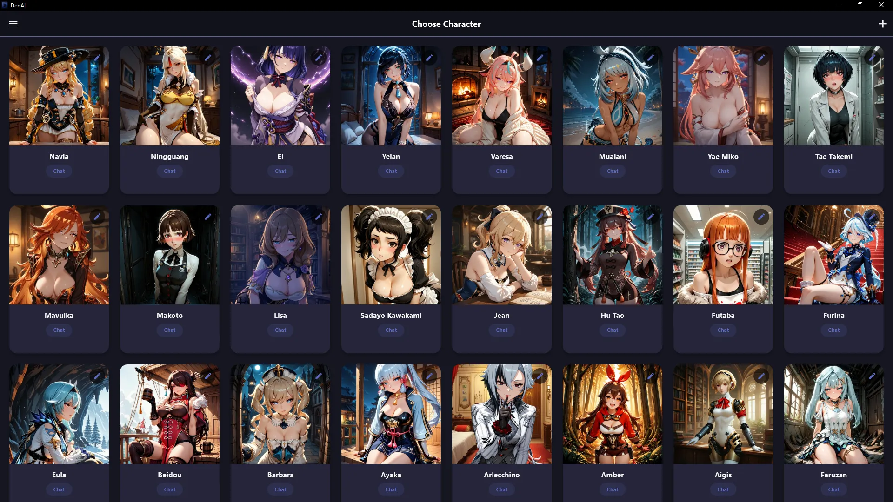
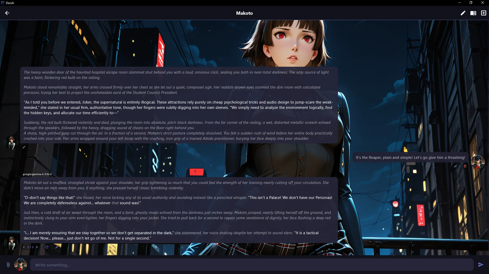

# DenAI

  DenAI is an open-source user interface designed for text-based roleplaying and chatting with Artificial Intelligence via OpenAI-compatible APIs. 
  
  The client supports both cloud-based services and local engines, including `llama.cpp`, `Ollama`, `KoboldCPP`, `LM Studio`, `Tabby`, `Ooba`, `Mistral`, `OpenRouter`, and other API aggregators. It runs as a standalone application without requiring console setups, external frameworks, or complex dependency installations.

 

## Screenshots

## Installation & Setup

1. Download the latest installer from the Releases page.
2. Run the executable and follow the installation prompts.

> [!WARNING]
> **Windows SmartScreen Notice**
> When running the installer, Windows may display a blue warning screen stating *"Windows protected your PC"*. This is standard behavior for independent open-source software. 
> 
> Obtaining a digital certificate from Microsoft involves regular corporate fees, which goes against the nature of a completely free, community-driven project. To bypass this, click **"More info"** and then choose **"Run anyway"**.

### First Launch Configuration

1. Open the menu and navigate to the **Settings** section.
2. In the API Provider block at the top, click **"Add Provider"**.
3. Enter a custom name, input your provider's API URL (default settings for local Ollama are pre-configured), and provide your API key. Click **"Save"**.
4. Once the connection status indicator changes to a successful checkmark, select your primary text model from the dropdown list below.
5. Click **"Save Settings"** to finalize the setup.

For a detailed breakdown of all available parameters, visit the [Documentation Page](https://realwaifu.ru/en/denai/settings).

## Core Architecture

### World & Character Management
* **V2-Card Standard:** Support for creating, importing, and exporting character cards using standard PNG metadata.
* **User Personas:** Customizable profile cards for roleplay interaction context.
* **Knowledge Bases (Lorebooks):** Semantic matching and dynamic context injection utilizing vector search.

### Context & Model Control
* **Chat Management:** Inline editing, response deletion, and swipe-to-regenerate capabilities.
* **Auto-Summarization:** Automated context window management with manual editing support.
* **Vision Support:** Image recognition capabilities for multimodal models.
* **LLM Tuning:** Custom generation parameters (Sampling) and persistent global system instructions.

## System Requirements
The client itself consumes very few resources and will run on any device with Windows 10 / 11 (64-bit). However, DenAI is only an interface; you will need access to an LLM backend. If you use cloud providers, all you need is a stable internet connection. For local execution, the requirements depend on the model itself.
